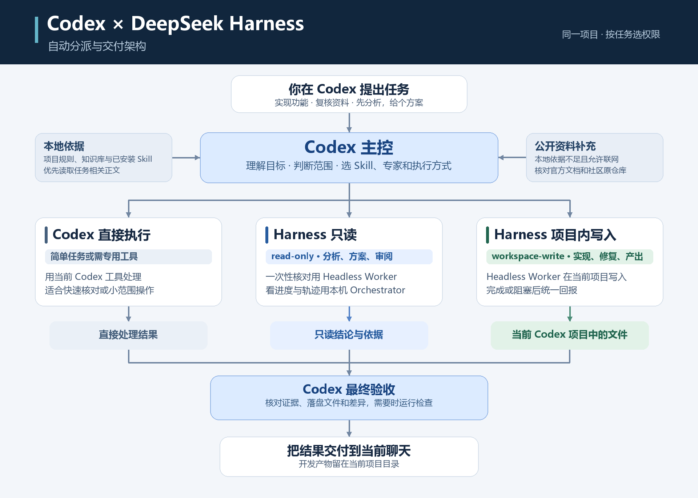

# Codex + DeepSeek Harness

[English](README.md) · **简体中文**

直接用自然语言给 Codex 布置任务。Codex 可以处理简短的检查，也可以派 DeepSeek Harness 做独立复核或组织多个专家。当你要求实现功能、修复问题或保存交付物时，Codex 可以让 Harness 在当前项目直接产出。Codex 负责确定范围和验收结果。

适用于范围明确的开发、发布核对、文档比对和批量审查。本集成支持 Windows x64，默认只读，已用 **DeepSeek Harness 0.2.2-rc.5** 验证。

> 按已批准的规则核对这批发布资料。验证总量并引用表格原文，按需安排专业复核。保持输入只读，给出放行结论及依据。

在一次合成数据测试中，Codex 本地核对后，又派一名 Harness 专家独立复核同样的九份文件。双方都发现正式更正将某地区的有效数量从 85 降到 79，比放行门槛少 1。Codex 核实证据后判定不能放行。

## 架构图



## 快速开始

1. 安装并登录 Codex 和 [DeepSeek Harness](https://www.deepseek.com/harness/)。至少打开一次 Harness 桌面版初始化配置，然后从系统托盘退出。
2. 准备 Python 3.12 或更高版本、Node.js 22 或更高版本（`node.exe` 同目录有 `npm.cmd`），以及 Git。
3. 克隆或解压仓库，在根目录打开 PowerShell。用本机可执行文件的完整路径替换命令中的占位符。第一条预演，第二条应用。

```powershell
python .\install.py --harness-exe "<absolute path to DeepSeek Harness.exe>" --node-exe "<absolute path to node.exe>"
python .\install.py --harness-exe "<absolute path to DeepSeek Harness.exe>" --node-exe "<absolute path to node.exe>" --apply
```

4. 在要操作的项目中创建新的 Codex 聊天。你可以要求只读复核，也可以说明要[实现什么改动](#项目内修改)。可以用[合成数据验证](#用合成数据验证)分别测试两条路线。

安装器按需获取固定版本的桥接器和锁定的依赖，使用 `~/.codex` 或已配置的 `CODEX_HOME`。升级已知版本时会备份 Worker 和策略。遇到冲突的自定义文件会保留。独立启动器及本机状态位于该目录下的 `integrations/dsh-orchestrator`。运行时复用本机安装的 Harness 及其登录状态。

| 安装组件 | 用途 |
|---|---|
| [Worker Skill](skills/deepseek-harness-worker/SKILL.md) | 启动一次性 Headless 任务。默认只读，也支持按任务范围修改工作区 |
| [Orchestrator](launch.py) | 通过本机 MCP 派发只读任务，查看进度和轨迹，并在原会话续派 |
| [自动分派策略](codex-delegation-policy.md) | 配置任务选档、专家交接和验收规则 |

### 可选参数

| 参数 | 用途 |
|---|---|
| `--context-insights` | 在独立 Web 配置安装 `dsh-context 0.86.0`，用于浏览会话和轨迹。插件会请求公开元数据，并向所选提供方查询账户余额 |
| `--share-harness-skills` | 将你自己的 Harness Skill 目录链接到独立 Web 配置。使用前先检查将被委派任务访问的 Skill |
| `--desktop-privacy` | 在桌面版已退出时应用[桌面隐私配置](privacy/desktop.patch.yml)，并备份现有覆盖文件。配置会停用额外会话日志上传、遥测、思考过程云端翻译，以及 Harness 反向派活给 Codex |

## Codex 如何分派任务

Codex 直接处理简短检查，一次性的委派使用 Worker Skill。需要实时进度、原生轨迹或同会话续派的只读任务，使用 Orchestrator。默认用简体中文写会话标题、交接内容和结果。可在任务里指定其他语言。

| 任务 | Harness 模式 | 模型与推理等级 |
|---|---|---|
| 定点查值或提取字段 | 标准 | Flash / Low |
| 比对文档或归纳日志 | 标准 | Flash / High |
| 批量读取、筛选或汇总独立输入 | PTC | Flash / High |
| 裁决证据冲突或评估多个相互影响的约束 | 标准 | Pro / High |

### 项目内修改

要求实现功能、修复问题或保存交付物，通常已包含完成该任务所需的当前项目写入。Codex 判断是否委派，并核对项目规则、既有改动和可修改文件。只有写入范围存在实质疑问时才另外确认。

委派时，Codex 用 `--cwd` 将当前项目的绝对路径传给 Headless Worker，为当次任务启用 Harness 原生 `workspace-write`。专家连续完成整项交付，再统一报告实际改动、检查结果和阻塞。Worker 结束后，Codex 检查落盘文件和差异，运行相关项目检查后验收。

查看、审阅、分析和给方案默认只读。用户指定的只读限制优先。Orchestrator 保持只读，可以复核完成后的产出。安装、提交和发布分别按实际任务授权执行。

### 专家交接与补查

Codex 决定专家人数和角色。独立的只读任务可以并行。有依赖的阶段在 Codex 核对上游证据后启动。Codex 根据各专家的职责匹配项目规则及可用 Skill，交接时写明输入、来源、交付物和检查标准。返回的证据可以核对实际采用的资料和 Skill。

在另一项合成测试中，首位专家统计了 52 个合格单位。复核专家发现放行门槛缺少来源，暂停了验收。Codex 续派回首位专家的原会话，取得已批准的门槛 50，由原复核专家确认更正后再派发独立终审。最终高出门槛 2 个单位。

Orchestrator 的 `dsh_followup` 可在原任务补查。交接时只带下一位专家需要的证据和引用。Harness 的**智能体团队协作**开关负责同一会话内的协作。由 Codex 管理的这套流程在该开关关闭时也能跨会话协调专家。

### 本地依据不足时查找公开资料

任务允许联网时，Codex 可以用已有搜索工具补充本地规则或已安装 Skill 未覆盖的部分。

1. 用通用公开关键词查找官方规范或维护者文档。
2. 核对社区项目的原始文档、源码或维护记录。考虑复用时核对版本和许可。分别记录规范要求和具体实现的行为。
3. 用已核实的资料继续完成任务，保留来源链接和验证结果。安装、启用、导入第三方 Skill 或执行脚本需要相应授权。

一次含八项 JSON Pointer 用例的只读合成测试验证了这条路线。Codex 打开 RFC 6901 后派发独立复核。Harness 使用原生搜索和网页抓取核对 RFC 和社区原仓库。结果与预期的五项取值和三项失败一致，期间未安装 Skill。 [RFC 6901](https://www.rfc-editor.org/rfc/rfc6901.html)

## 查看进度与轨迹

运行 `codex mcp get dsh_orchestrator` 查看 MCP 注册。执行过程中，Codex 可以通过 `dsh_status`、`dsh_wait` 和 `dsh_tail` 读取进度和事件。

Orchestrator 按需在 `127.0.0.1` 启动 Harness Web。你可以照常使用 Harness 桌面版。要查看桥接任务在独立本机配置中的原生轨迹，在 PowerShell 运行以下命令，查看期间保留窗口。

```powershell
$codexConfig = if ($env:CODEX_HOME) { $env:CODEX_HOME } else { Join-Path $env:USERPROFILE '.codex' }
python (Join-Path $codexConfig 'integrations/dsh-orchestrator/launch.py') --view
```

安装上下文洞察后，打开**上下文洞察 → 全部会话**，按标题找到会话并点**轨迹**。

## 用合成数据验证

### 只读复核

生成一个临时工作区，在创建 Codex 聊天时选择命令打印的路径。

```powershell
$fixture = Join-Path $env:TEMP ("harness-smoke-" + [guid]::NewGuid().ToString("N"))
New-Item -ItemType Directory -Path $fixture -ErrorAction Stop | Out-Null
11..22 | ForEach-Object {
    $state = if ($_ % 2) { "ready" } else { "hold" }
    "item-${_}:${_}:$state" | Set-Content -LiteralPath (Join-Path $fixture "part-$_.txt") -Encoding ASCII
}
$fixture
```

> 并行只读这 12 份 part-*.txt 文件，统计 ready 的条目数与数量合计。显示 Harness 进度与原生轨迹，并交叉核对两条原始记录。

预期为 **6 条 ready，数量合计 96**。核对 Codex 发起了委派、任务以只读方式完成、轨迹显示源文件读取，且输入文件与测试前一致。模式和模型由 Codex 按任务选择。

### 项目内产出

新建一个临时项目，放入 `requirements.txt`，要求实现 Python 函数 `total(count)`。前三张票每张 12 分，之后每张 8 分，负数应抛出 `ValueError`。再放一个 `original.txt` 用于核对既有文件。用该项目创建新 Codex 聊天并发送下面的请求。

> 按 requirements.txt 在 tickets.py 实现票价函数。保留现有文件，验证结果并报告实际写入的路径。

核对 Headless Worker 使用了 `workspace-write`，Harness 在该项目创建了 `tickets.py`，Codex 验收了实际文件。合成测试里唯一新增文件是 `tickets.py`，六个用例均通过。票数为 0、1、3、4、9 时，费用分别为 0、12、36、44、84 分。负数触发 `ValueError`。

## 数据处理

Headless 和独立 Web 配置默认停用额外会话日志上报和反馈遥测。委派任务默认使用 Harness 原生只读权限。授权的 Headless 修改只在当次任务使用原生工作区写入。云模型调用会发送完成任务所需的提示与上下文，请按任务提供已授权的信息。需要数据留在本机时，使用已验证的本地推理与离线工具。 [Harness 隐私政策](https://www.deepseek.com/harness/privacy/) · [官方会话日志说明](https://github.com/deepseek-ai/deepseek-harness/blob/master/packages/session/session-log-deepseek/README.md)

桌面插件、桌面 MCP、外部程序、账户和聊天记录分别在各自电脑上配置。换版本后用合成数据复验权限、选档和隐私设置。

## 回退

退出相关 Codex 聊天与 Harness 窗口。运行 `codex mcp remove dsh_orchestrator` 移除注册。删除 `AGENTS.md` 中起始与结束标记之间的托管分派块。清理前先备份 Worker Skill、程序定位文件、独立配置及会话。

如果要回退已知版本升级，用安装器报告的 Worker 和策略备份恢复。应用过桌面隐私配置时，恢复备份前先检查后续改动，也可以只撤销带标记的隐私配置块。

## 固定来源

安装使用 [Fly2Kiana/Codex-DSH-Orchestrator](https://github.com/Fly2Kiana/Codex-DSH-Orchestrator) 的提交 `428c69f590d569b0c7cfbdb831bfa88beedc938b` 构建 Orchestrator。Harness 和可选社区插件遵循各自的许可及条款。
